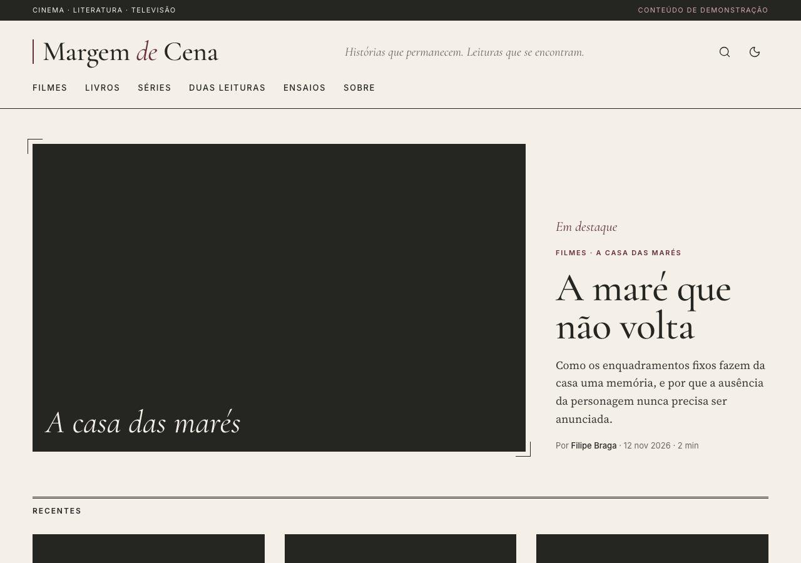
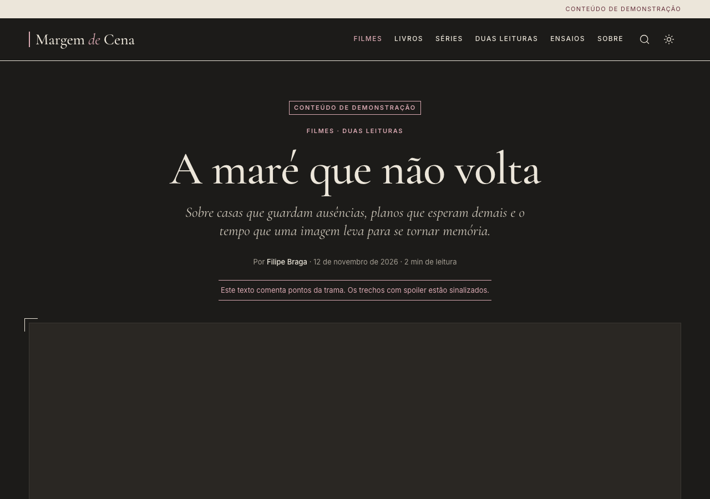
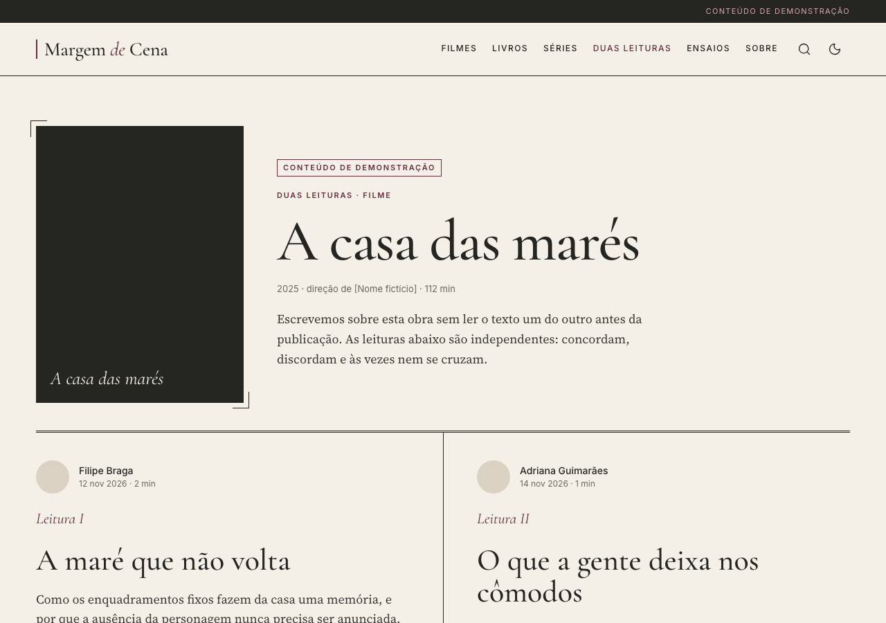

# Margem de Cena

> Publicação cultural independente sobre cinema, literatura e televisão.

The website of Margem de Cena, an independent Brazilian publication written by Filipe Braga and
Adriana Guimarães. It publishes long-form texts about films, books and series, and **Duas
Leituras**: two independent readings of the same work, one by each author, linked to each
other. It is a statically generated Next.js site whose content lives in this repository as MDX
and YAML, so publishing a text is a pull request.

## Screenshots

Taken from a build with demonstration content, which the production site never shows.

| Home (light) | Article (dark) |
| --- | --- |
|  |  |

| Duas Leituras | Article on a phone | Home on a phone (dark) |
| --- | --- | --- |
|  |  |  |

## Stack

- **Next.js 16** (App Router, React Server Components, static generation) and **React 19**
- **TypeScript** in strict mode, with `noUncheckedIndexedAccess`
- **Tailwind CSS v4**, with the design tokens as CSS variables
- **Content:** MDX (`@mdx-js/mdx`) and YAML, validated with **Zod** at build time
- **Fonts and images:** `next/font` (Cormorant Garamond, Source Serif 4, Inter) and
  `next/image`; share images rendered with `next/og`
- **Quality:** ESLint, Prettier, Vitest, Playwright with `@axe-core/playwright`, and Husky,
  lint-staged and commitlint
- **Delivery:** pnpm and Node.js 26, GitHub Actions for CI, Vercel for hosting

No database, accounts, comments, CMS, analytics or newsletter in this first version.

## Decisions

Each significant choice has an architecture decision record in [`docs/adr/`](docs/adr/):

| ADR | Decision |
| --- | --- |
| [0001](docs/adr/0001-static-generation-with-next-app-router.md) | Static generation with the Next.js App Router |
| [0002](docs/adr/0002-file-based-content-layer.md) | A file-based content layer behind typed queries, ready to be replaced by a CMS |
| [0003](docs/adr/0003-mdx-compilation-with-mdx-js.md) | MDX compiled with `@mdx-js/mdx`, with an allowlist of components |
| [0004](docs/adr/0004-demo-content-isolation.md) | Demonstration content kept apart, and never in production |
| [0005](docs/adr/0005-theme-switching-without-a-library.md) | Light and dark themes without a library and without a flash |
| [0006](docs/adr/0006-quality-gates-and-branch-workflow.md) | Quality gates, CI and the branch workflow |
| [0007](docs/adr/0007-explicit-inline-tag-mentions.md) | Tags marked explicitly in the text |
| [0008](docs/adr/0008-client-side-search.md) | Search in the browser over an index built at build time |
| [0009](docs/adr/0009-seo-metadata-and-open-graph-images.md) | SEO metadata, structured data and generated share images |
| [0010](docs/adr/0010-images-in-the-body-and-image-dimensions.md) | Images in the body, measured at build time |
| [0011](docs/adr/0011-static-category-archive-pages-and-tag-filters.md) | Static archive pages with pagination and tag filters |
| [0012](docs/adr/0012-instagram-sharing-through-the-system-share-sheet.md) | Instagram sharing through the system share sheet, without a link or SDK |

## Running locally

Requirements: Node.js 26 (see `.nvmrc`) and pnpm 12 (pinned in `package.json#packageManager`).

```sh
pnpm install
SHOW_DEMO_CONTENT=true pnpm dev
```

Open http://localhost:3000. Without `SHOW_DEMO_CONTENT=true`, the site shows only published
content, which is what production shows. With demonstration content enabled, the styleguide is
at http://localhost:3000/styleguide.

## Publishing a new text

The writers' guide, [Como publicar](docs/como-publicar.md) (pt-BR), covers every step. In
short:

1. Create a branch, for example `content/a-mare-que-nao-volta`.
2. Add `content/articles/<slug>.mdx` with its frontmatter (title, category, authors, status,
   date), plus the work in `content/works/` and any images in `public/images/` with credit and
   licence. The file name is the permanent URL.
3. Commit with a message like `content: publish "A maré que não volta"` and open a pull request.
4. CI validates the content: schemas, authors, works, Duas Leituras pairs, images, tags, and no
   drafts. Merging to `main` publishes the text.

## Scripts

| Command | What it does |
| --- | --- |
| `pnpm dev` | Development server |
| `pnpm build` / `pnpm start` | Production build and server |
| `pnpm check` | Typecheck, lint, unit tests and the no-drafts check (run before every commit) |
| `pnpm typecheck` · `pnpm lint` · `pnpm test` | Each check on its own |
| `pnpm test:e2e` | Smoke and accessibility tests (Playwright and axe) on a production build with demo content, at 360, 768 and 1280 px |
| `pnpm format` / `pnpm format:check` | Format with Prettier, or only check |
| `pnpm verify:production-build` | After `pnpm build` without demo content, fails if demo content reached any page, the search index or the sitemap |
| `pnpm check:placeholders` | Lists the `[A PREENCHER: …]` texts still to be written; `--strict` fails while any is left |

The first end-to-end run needs a browser: `pnpm exec playwright install chromium`.

## Deploying on Vercel

1. Import the GitHub repository in Vercel. The framework (Next.js), the build command and the
   output are detected automatically.
2. Set the environment variables per environment:

   | Variable | Production | Preview | Development (local) |
   | --- | --- | --- | --- |
   | `NEXT_PUBLIC_SITE_URL` | The final domain, e.g. `https://margemdecena.com.br` | The same final domain, so canonical URLs always point to the real site | Unset (defaults to `http://localhost:3000`) |
   | `SHOW_DEMO_CONTENT` | `false` or unset. The build fails if it is `true` | `true`, to review the layout with demonstration content | `true` when you want demonstration content |

   `VERCEL_ENV` is set by Vercel. Only `production` opens the site to search engines
   (`robots.txt` and the `robots` meta tag); previews stay `noindex`.
3. Production deploys from `main`; every pull request gets a preview deployment.
4. Before launch:
   - set the final domain;
   - replace every `[A PREENCHER: …]` text (`pnpm check:placeholders` lists them). The
     production build fails while any is left in published content or author data;
   - set the publication's contact e-mail and Instagram handle in `src/lib/site-config.ts`.

The Node.js version comes from `package.json#engines`. If the build image does not offer
pnpm 12, add `ENABLE_EXPERIMENTAL_COREPACK=1` so Vercel uses the version pinned in
`packageManager`.

## Quality

- **CI** (GitHub Actions) runs on every pull request:
  - typecheck, lint, format check and unit tests;
  - commitlint, including a rule that rejects AI attribution;
  - the no-drafts check;
  - a production build with the demo-leak check;
  - the end-to-end and accessibility suites.
- **Accessibility:** axe finds no WCAG 2.2 A/AA violations on any page template, in either
  theme, at any of the three widths.
- **Lighthouse** (mobile):
  - 100 in all four categories on the home page and Sobre, on a production build;
  - 99 in performance and 100 in accessibility and best practices on an article, on the demo
    build. That build is `noindex` on purpose, which lowers its SEO score.

  The [quality review](docs/quality-review.md) lists the findings and fixes.

## Project structure

```
content/          articles, authors, works, Duas Leituras and pages (MDX + YAML)
content/demo/     demonstration entries, read only when SHOW_DEMO_CONTENT=true
src/app/          routes (thin: query the content layer, compose components)
src/components/   presentational components, grouped by domain (layout, ui, cards, article,
                  archive, mdx, home, search, seo, og)
src/content/      content layer: schemas, loaders and queries; the only code that reads files
src/lib/          pure utilities: categories, dates, slugs, pagination, search, SEO,
                  environment, theme, site config
scripts/          repository checks (drafts, demo leaks, placeholders, commit messages)
tests/            end-to-end and accessibility tests
docs/             brief, design system, ADRs, conventions, quality review, writers' guide
```

## Documentation

- [Product brief](docs/briefing.md)
- [Design system](docs/design-system.md)
- [Architecture decision records](docs/adr/)
- [Engineering conventions](docs/engineering-conventions.md)
- [Quality review](docs/quality-review.md)
- [Como publicar](docs/como-publicar.md): the writers' guide (pt-BR)

## Workflow

Work happens in stages, one branch and pull request per stage, with Conventional Commits.
Each pull request description is the stage report. `main` is always deployable
([ADR 0006](docs/adr/0006-quality-gates-and-branch-workflow.md)).

## License

- **Code:** [MIT](LICENSE).
- **Texts** in `content/` (articles, bios, institutional pages): all rights reserved; see
  [content/LICENSE.md](content/LICENSE.md).
- **Images:** each image carries its own credit and licence.
- **Fonts:** the fonts are under the SIL Open Font License.
